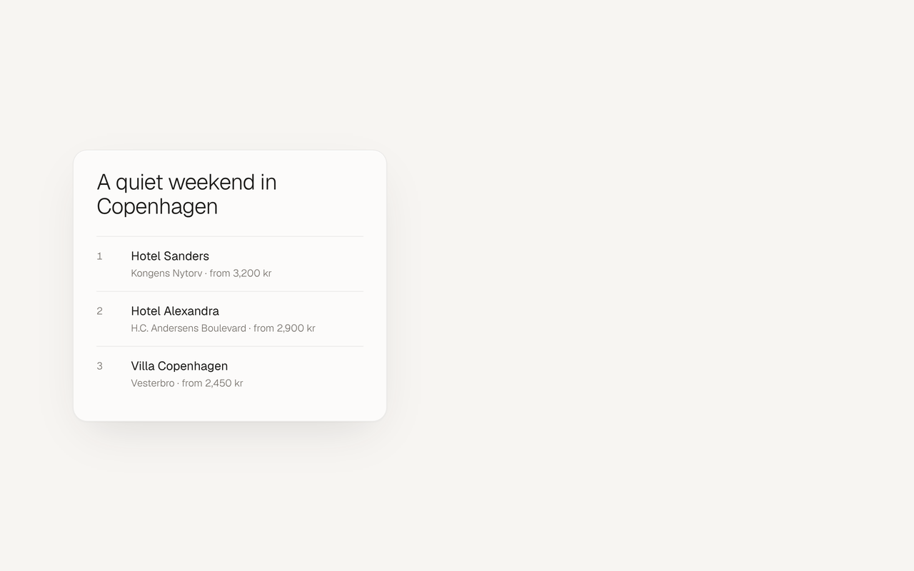

<p align="center">
  
</p>

<h1 align="center">ephemeralOS</h1>

<p align="center">A voice-only, agentic OS in the browser.<br>You talk to an orb. It talks back.</p>

---

The screen only shows something when voice isn't enough, and then it gets out of the way. There
is nothing to type, tap or click once it's running. It remembers, hands deep work to a stronger
model, and reports back when it's done.

Open source, bring your own API keys, local-first.

<p align="center">
  
</p>

> **Status:** early. The orb (M1), the voice loop (M2), the display (M3) and quick web search
> are here; background deep work (the rest of M4) is next.
> See the [roadmap](#roadmap).

## Principles

1. **Voice is the only input.** One click to grant the microphone is the single exception.
2. **The screen is ephemeral output.** Everything shown is numbered so it can be addressed by
   voice, and it fades when it's no longer relevant.
3. **Say the gist, show the detail.** Never a table read aloud.
4. **Keys never touch the browser.** They live in the local gateway's `.env`.
5. **Local-first.** A single Node process on `127.0.0.1` is the control plane; the browser is a
   thin body.
6. **Model-agnostic.** Voice and brain providers sit behind adapters.
7. **Human-readable state.** Memory, persona and config are files you can open.
8. **Safe by default.** No shell, no arbitrary file access, nothing exposed to the network.

The full brief is in [`docs/BRIEF.md`](docs/BRIEF.md).

## Quick start

You need Chrome, a microphone, speakers and an OpenAI API key. Install with one line, which
also sets up Node if you don't have it:

```sh
# macOS and Linux
curl -fsSL https://raw.githubusercontent.com/tongesy/ephemeralos/main/scripts/install.sh | sh
```

```powershell
# Windows (PowerShell)
irm https://raw.githubusercontent.com/tongesy/ephemeralos/main/scripts/install.ps1 | iex
```

The installer asks for your keys, then you start it:

```sh
ephemeralos start       # http://localhost:4317
```

Run the installer again to update. If you already have Node 22.12+, npm works too:

```sh
npx ephemeralos init
npx ephemeralos start
```

Or, from a clone, with Node 22.12+ and pnpm 10:

```sh
pnpm install
pnpm ephemeralos init   # API keys, name, voice, wake-word models → ~/.ephemeralos
pnpm build
pnpm start              # http://localhost:4317
```

Open <http://localhost:4317> in Chrome and click once to grant the microphone. Then say
**"Hey Jarvis"**. Talk normally, interrupt whenever you like, and say "that's all" (or just stop
talking for ten seconds) to send it back to sleep.

When something is easier to see than hear, it appears on the page: a card, a numbered list, a
table or a chart. Say "open number two", "next", "back", "scroll down", "make it bigger" or
"dismiss". Everything fades on its own after a minute or two, and the screen clears soon after the
conversation ends. Ask "what's the weather this
week?" and you hear a short summary while the forecast appears as a table. Weather comes from
[Open-Meteo](https://open-meteo.com), which needs no key; `init` asks where you are.

For anything current, such as the news, prices or scores, the orb searches the web. It says a
line or two and shows a short summary with its sources. Searches use Claude when you've given
`init` an Anthropic key, and OpenAI otherwise; set the models in `config.json` under `brain`.

`init` is the only setup step, and it happens in the terminal: keys are typed there, hidden,
and saved to `~/.ephemeralos/.env` (mode `600`). They are never typed into, sent to, or spoken
by the orb. Re-run it any time to change a key; your persona and memory files are never
overwritten.

The wake word is detected in the browser with [openWakeWord](https://github.com/dscripka/openWakeWord).
Its pretrained models are CC BY-NC-SA 4.0 (personal, non-commercial use), so `init` downloads
them to your machine rather than ephemeralOS bundling them. Skip them and a click on the page
starts a conversation instead. A custom "Hey Orb" model is on the roadmap.

A USB speakerphone helps a lot across a room: it cancels echo far better than laptop speakers.

### Always-on display (Omarchy)

ephemeralOS can run full screen on a spare laptop, starting on login and never sleeping. These
steps are for [Omarchy](https://omarchy.org) (Arch and Hyprland), and are written so you can
hand them to an assistant to run. The details are in [`docs/kiosk.md`](docs/kiosk.md).

1. Install, and enter your keys when asked:
   `curl -fsSL https://raw.githubusercontent.com/tongesy/ephemeralos/main/scripts/install.sh | sh`
2. Start it on login by adding this line to `~/.config/hypr/autostart.conf`:
   `exec-once = ~/.local/share/ephemeralos/app/deploy/linux/ephemeralos-kiosk`
3. Keep the screen on: in `~/.config/hypr/hypridle.conf`, comment out every `listener { ... }`
   block, then run `pkill hypridle; hypridle >/dev/null 2>&1 & disown`.
4. Keep it awake with the lid closed:
   `sudo mkdir -p /etc/systemd/logind.conf.d && sudo cp ~/.local/share/ephemeralos/app/deploy/linux/no-lid-sleep.conf /etc/systemd/logind.conf.d/ && sudo systemctl kill -s HUP systemd-logind`
5. Run `~/.local/share/ephemeralos/app/deploy/linux/ephemeralos-kiosk` (or log out and back
   in). Chromium opens full screen. Allow the microphone once and it's remembered.

The kiosk script restarts the gateway and the browser together if either one exits.

### Development

```sh
pnpm dev                # gateway (watch) + Vite on http://localhost:5173
```

In development builds, the keyboard drives the orb so you can see every state:

| Key                                            | Action                                                       |
| ---------------------------------------------- | ------------------------------------------------------------ |
| <kbd>Space</kbd> / <kbd>→</kbd> / <kbd>←</kbd> | Next / previous state                                        |
| <kbd>1</kbd>–<kbd>5</kbd>                      | Zen, listening, thinking, speaking, error                    |
| <kbd>A</kbd>                                   | Voice preview: talking switches to listening (without a key) |
| <kbd>D</kbd>                                   | Cycle demo displays: list, card, table, update, chart, clear |
| <kbd>P</kbd>                                   | Frame-time readout                                           |
| <kbd>V</kbd>                                   | Toggle simulated voice output (without a key)                |
| <kbd>W</kbd>                                   | Wake: start a voice session without saying the wake word     |

None of this exists in production builds.

## How it fits together

```
Browser (the body)                          Gateway (local Node process, 127.0.0.1)
┌────────────────────────────────┐          ┌───────────────────────────────────────┐
│ Orb (three.js plasma shader)   │          │ Serves the client, injects a          │
│ Audio levels (AnalyserNode)    │◀── WS ──▶│   per-launch token                    │
│ Wake word (openWakeWord, WASM) │  token,  │ Mints short-lived Realtime secrets;   │
│ Voice session (WebRTC)         │  origin, │   the API key never leaves            │
│ Display components (M3)        │  host    │ Tool calls, transcripts; jobs and     │
└───────────────┬────────────────┘  checked │   memory from M4–M5                   │
                │                           └───────────────────────────────────────┘
                │ audio + events, only while a session is open
                ▼
        OpenAI Realtime
```

| Package                                | Role                                                              |
| -------------------------------------- | ----------------------------------------------------------------- |
| [`packages/gateway`](packages/gateway) | Local control plane: HTTP, WebSocket, Realtime secrets, tools     |
| [`packages/web`](packages/web)         | The browser body: orb, audio, wake word, voice session, display   |
| [`packages/cli`](packages/cli)         | `ephemeralos init` and `ephemeralos start`                        |
| [`packages/shared`](packages/shared)   | zod schemas and types shared by all of them                       |
| [`home`](home)                         | Starting persona, memory and settings, copied to `~/.ephemeralos` |

## Privacy

The wake word is detected in the browser; until it fires, no audio leaves your machine. Audio
then goes to OpenAI only while a voice session is open, and the session closes on a sleep phrase
or ten seconds of silence. From M4, delegated tasks go to Anthropic. Keys, persona, memory and
transcripts (`transcripts/YYYY-MM-DD.jsonl`) stay in `~/.ephemeralos/`.

## Roadmap

- [x] **M0** Scaffold: workspace, gateway, tokens, type, CI
- [x] **M1** The orb: plasma, five states, audio-shaped, glides into open space
- [x] **M2** Voice loop: `init`, wake word, Realtime session, barge-in, fallback
- [x] **M3** Display: cards, lists, tables, charts, voice navigation, live weather
- [ ] **M4** Delegate: quick web search (done), async deep-work jobs
- [ ] **M5** Memory: remember, recall, forget
- [ ] **M6** Polish and release

## Contributing

`pnpm check` runs formatting, lint, types, tests and the build: the same as CI. Conventions
are in [`CLAUDE.md`](CLAUDE.md); design notes in [`docs/design.md`](docs/design.md); the
performance budget and how to measure it in [`docs/performance.md`](docs/performance.md).

To release, push a tag such as `v0.1.0`. The [Release workflow](.github/workflows/release.yml)
publishes that version to npm as `ephemeralos`, using the repository's `NPM_TOKEN` secret.
`pnpm pack:npm` builds the same package locally in `dist-npm/`.

## License

[MIT](LICENSE)
